### Hi, I'm Daniel 👋

I build backends, data pipelines and the infrastructure that keeps them running, from Vienna, Austria. Most of that work isn't public, so this profile is the side view: the tools I wrote because I wanted them to exist, and the occasional patch to a dependency that didn't do what I needed.

- 🔭 Building **[loom](https://github.com/DanielC000/loom)** — it runs a fleet of Claude Code agents on a subscription instead of per-token API bills. 
- 🧰 Most at home in **C#/.NET, Python and TypeScript**, usually with PostgreSQL underneath and Docker or Kubernetes around it.
- 🧱 I care a lot about clean, robust code, and about thinking the architecture through before writing it. Mostly I just like taking a messy problem apart until what's left is simple enough to build. Divide et impera.
- 🌱 Getting my first hands-on experience with Rust — learning the language is the fun part, finding the time for it is the hard part right now.
- 📫 Reach me at **office@chenari.dev**

#### Languages and tools

#### Stats

<picture>
  <source media="(prefers-color-scheme: dark)" srcset="profile/snake-dark.svg">
  <source media="(prefers-color-scheme: light)" srcset="profile/snake.svg">
  
</picture>
